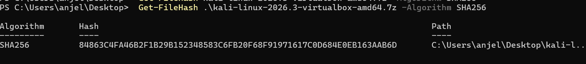
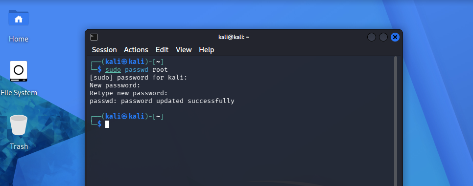
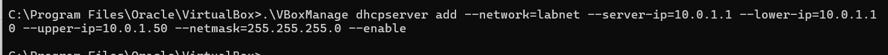
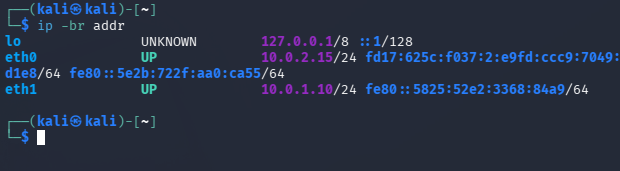
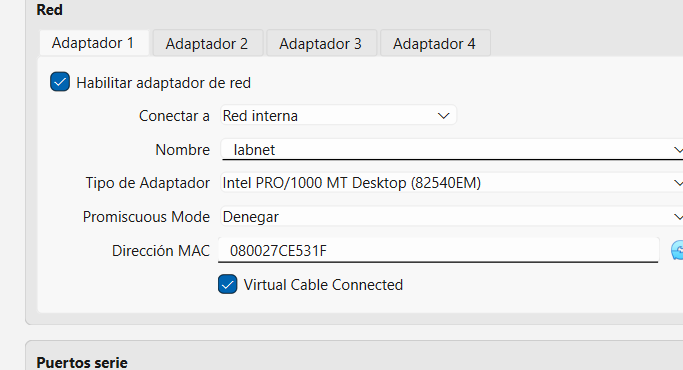
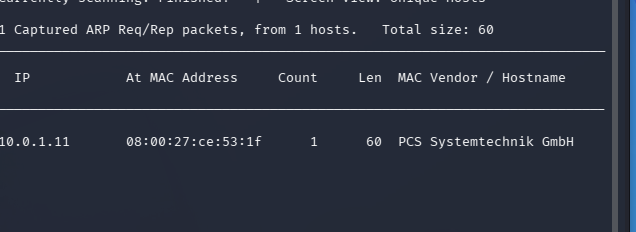
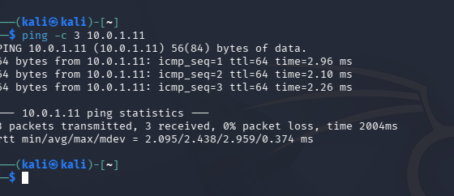

##    PRÁCTICA LABORATORIO

**1.¿Por qué DC-1 no debe tener adaptador NAT ni puente?**

La máquina DC-1 no debe configurarse con los adaptadores NAT/Puente por la razón principal de seguridad y aislamiento.
Al ser una máquina diseñada para ser atacada, contiene puertas traseras y servicios desactualizados.

*Adapatador puente* Contecta la máquina a mi router físico, es decir obtiene mi propio ip y es visibile para cualquier otro dispositivo conectado.

*Adaptador NAT* Conexión saliente al internet puede permitir que la máquina vulnerable realice conexiones hacia el exterior y tiene acceso a la red del anfitrión;
un programa malicioso dentro de la máquina podrá escanear puertos locales.

**2.¿Para qué sirve el servidor DHCP que creaste en H3?**

Aislamiento y control total.Solo existe comunicación entre las máquinas virtuales conectadas a ese mismo segmento de red.

Garantiza que no se repitan direcciones IP entre las máquinas virtuales del laboratorio.

Simulación de entornos reales.

**3.¿Qué hacen netdiscover y ping, y qué información te dio cada uno?**

*Netdiscover:* Herramienta de reconocimiento descubrimiento de dispositivos activos en una red local mediante el protocolo ARP (traduce una dirección en una MAC)
Me permitió ver el ip y el MAC de mi máquina DC

*Ping:* Comprueba si un equipo servidor/equipo está conectado y mide el tiempo que tardan los datos en viajar.
En este caso, el ping está comprobando si hay una conectividad de red entre ambas (labnet).

Con el comando estoy pidiendo que se envien 3 paquetes (kali) a la dirección de DC-1
Mostrando el tiempo y si se produjo alguna pérdida

 
 

Comprobación del hash

Modificar mi contraseña

Creación de mi la red interna para mi laboratorio

Prueba de existencia de red interna

DC-1

Comprobación de la conectividad entre las dos maquinas

Ping

